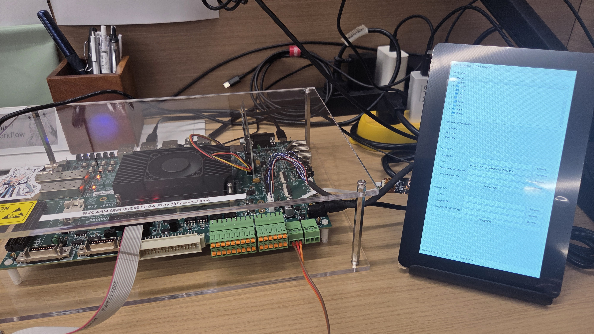

# FPGA-AES-PCIe


## 1. Project Overview
DEMO video at: https://www.bilibili.com/video/BV1XLpi67ETH/

This project integrates an AES-128 encryption core into a Pango Microsystems PG2T390H FPGA (encryption dataflow bandwidth ~533Mbps) and exposes it to an RK3588 Arm Linux host over PCIe. The FPGA contains a BDMA scatter-gather engine connected to a PCIe Gen3.0x4 endpoint (based on Pango's bdma_pcie demo v0.4). The host side consists of a Linux kernel driver, a low-level userspace DMA demo, and a Qt5 GUI that supports text encryption, file encryption, and long-duration encryption/decryption automation.

The current hardware path accelerates AES-128 encryption. Host-side decryption uses a software AES fallback so the GUI can round-trip ciphertext back to the original plaintext.

## 2. Dependencies

- FPGA toolchain: PDS 2024.2-SP1.2-ads or later
- Target platform: RK3588 with LinuxSDK-v1.2 or later
- Host toolchain: buildroot with Qt5 lib (Widgets and Concurrent) when rebuilding `linux_sw`
- Development board: Tronlong TL3588F-EVM (https://www.tronlong.com/productinfo134.html)

## 3. Repository Layout

```text
.
├── README.md                  # Project documentation
├── .gitignore                 
├── bin/                       # Bitstream images for bdma_pcie demo v0.4 from Pango
├── GridLock-AES/
│   ├── sim/                   # QuestaSim testbench for the AES-128 wrapper
│   └── sources/               # AES-128 core, AXI wrappers, and stream adapter
├── linux_driver/
│   ├── bin/                   # Prebuilt PCIe/BDMA userspace demo binary
│   ├── driver/                # BDMA kernel module source and bdma.ko
│   └── src/                   # Userspace DMA/control demo and Makefile
├── linux_sw/
│   ├── build/                 # Cross-compiled Qt5 binaries and object files
│   └── src/                   # Qt5 GUI plus AES device and software AES code
└── project/
    ├── rtl/                   # FPGA top level, BDMA/PCIe IP, AES integration
    ├── constraints/           # PDS timing and pin constraints
    ├── compile/               # PDS compile step artifacts
    ├── synthesize/            # PDS synthesis artifacts
    ├── device_map/            # PDS device mapping artifacts
    ├── place_route/           # PDS place and route artifacts
    ├── report_timing/         # PDS timing reports
    ├── generate_bitstream/    # Bitstream generation outputs
    ├── ipcore/                # PDS IP core configuration files
    ├── log/                   # Current PDS tool logs
    └── logbackup/             # Archived PDS tool logs
```

## 4. Detailed Description

### 4.1 System Composition

The system has four main parts:

- **FPGA design** in `project/`. The top-level module is `project/rtl/bdma_pcie.v`. It instantiates the Pango PCIe endpoint and BDMA core from `project/rtl/bdma_pcie_ip`, the AES control/data wrappers, an AXI-Lite register slice, and the AES-128 core from `GridLock-AES/sources`.
- **Linux kernel driver** in `linux_driver/driver`. It registers character devices such as `/dev/bdma0_user`, `/dev/bdma0_ctrl`, `/dev/bdma0_h2c_N`, and `/dev/bdma0_c2h_N`.
- **Host userspace software**. `linux_driver/src` contains a command-line DMA transfer demo. `linux_sw/src` contains the Qt5 GUI and its AES device layer.
- **Testbench** in `GridLock-AES/sim`. `aes_tb_multiblock.sv` drives the AES-128 AXI wrapper and checks multi-block encryption.

### 4.2 FPGA to Host Communication

The control plane and data plane use separate paths.

**Control plane**

The host maps BAR0 through `/dev/bdma0_user`, or through `/dev/mem` as a fallback. The AES control registers are located at BAR0 offset `0x4000`:

| Offset | Width | Purpose |
| --- | --- | --- |
| `0x4000` | 32-bit | Key word 0, most significant 32 bits |
| `0x4004` | 32-bit | Key word 1 |
| `0x4008` | 32-bit | Key word 2 |
| `0x400C` | 32-bit | Key word 3, least significant 32 bits |
| `0x4014` | 32-bit | Key expansion start pulse |
| `0x4018` | 32-bit | Status register |

Inside the FPGA, BDMA AXI-Lite master transactions pass through an `axil_reg_slice` to shorten the timing path. An address decoder then routes accesses at or above `0x4000` to the AES wrapper and all other accesses to the on-chip AXI-Lite RAM.

**Data plane**

The AES data path uses BDMA AXI-Stream channel 0:

```text
Host plaintext
  -> /dev/bdma0_h2c_0
  -> BDMA H2C stream 0
  -> aes_axis_adapter
  -> aes_axi_wrapper / AES-128 core
  -> aes_axis_adapter
  -> BDMA C2H stream 0
  -> /dev/bdma0_c2h_0
  -> Host ciphertext
```

The stream adapter preserves `TLAST` and `TKEEP`, handles backpressure on both sides, and allows the DMA stream width to be decoupled from the AES core handshake. The host device layer reverses the bytes inside each 16-byte AES block to match the AXI-Stream wire order.

### 4.3 AES DSA Porting Notes

The pure AES DSA design sources were imported under `GridLock-AES/sources`.
Porting work should pay attention to these three integration layers:

- `aes_axi_wrapper.sv` wraps the AES core behind an AXI-Lite slave interface for key and status registers and AXI-Stream slave/master interfaces for plaintext and ciphertext.
- `aes_axis_adapter.v` adapts the BDMA 128-bit AXI-Stream channel to the AES wrapper stream interface.
- `bdma_pcie.v` contains the top-level integration. It uses stream channel 0 for AES data, decodes the AXI-Lite address space at `0x4000`, inserts an `axil_reg_slice` for timing convergence, and ties off the unused BDMA channels.

Two integration details:

- **Key word order**: address `0x00` of the AES register map maps to the most significant 32-bit word of the 128-bit key. The wrapper was corrected to match this host display order.

- **Multi-block operation**: the key schedule is reset to the original key at the start of each AES block so multiple 128-bit blocks can be encrypted consecutively.

The `aes_tb_multiblock.sv` testbench validates both the AXI wrapper and the multi-block behavior.

## 5. Quick Start

Build and load the kernel driver on the RK3588, then run the userspace demo or the Qt5 GUI. The GUI encrypts through the FPGA hardware path and decrypts with the software fallback.

```bash
cd linux_driver/driver/src
make
insmod bdma.ko

cd ../../../linux_sw
./run.sh
```

Prebuilt FPGA images are available.
